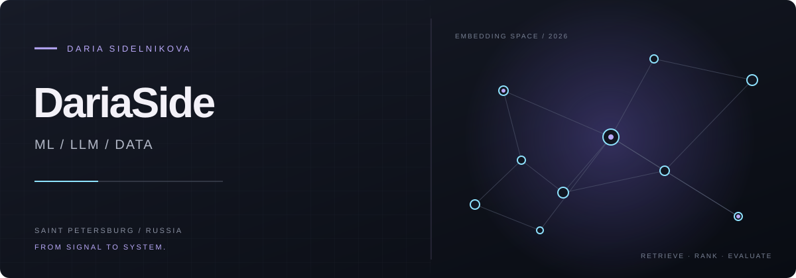
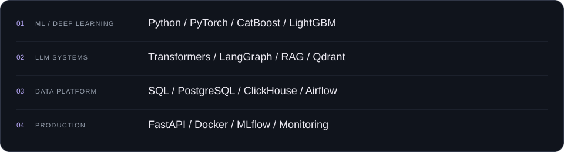

<p align="center">
  
</p>

<p align="center">
  <a href="https://github.com/DariaSide"></a>
  &nbsp;
  <a href="https://github.com/DariaSide?tab=repositories"></a>
</p>

## Daria Sidelnikova

**ML/LLM Engineer · Data Scientist**<br />
Saint Petersburg, Russia

I build production-ready LLM systems, RAG pipelines, AI agents, ranking models and applied ML solutions. I work across the full lifecycle: from data and experimentation to evaluation, APIs and monitoring.

<p><sub>I like measurable quality, clear system boundaries and ML that survives outside a notebook.</sub></p>

## 01 / Focus

<table>
<tr>
<td width="50%" valign="top"><h3>LLM &amp; RAG systems</h3><p>Document ingestion, chunking, embeddings, vector search, reranking, offline evaluation and production inference.</p><p><sub>Retrieval · Reranking · Evaluation · Semantic Search</sub></p></td>
<td width="50%" valign="top"><h3>AI agent workflows</h3><p>Multi-step pipelines with tool calling, routing, fallback strategies and automated quality evaluation.</p><p><sub>LangGraph · Tool Use · Routing · Guardrails</sub></p></td>
</tr>
<tr>
<td width="50%" valign="top"><h3>Ranking &amp; recommendations</h3><p>Learning-to-rank, behavioral features, user and item embeddings, online inference and A/B testing.</p><p><sub>LTR · Recommenders · Features · Experiments</sub></p></td>
<td width="50%" valign="top"><h3>Quantitative ML</h3><p>Research for market microstructure, order books, time series, signal generation and backtesting.</p><p><sub>Time Series · Research · Backtesting · Signals</sub></p></td>
</tr>
</table>

## 02 / Under the hood

<p><picture><source media="(max-width: 600px)" srcset="assets/stack-mobile.svg" /></picture></p>

## 03 / Selected work

| Project | What is inside |
| :--- | :--- |
| **[Functional Analysis Laboratory](https://github.com/DariaSide/FunctionalAnalysis_Laboratory)** | Python experiments and computational work in functional analysis. |
| **[DATA](https://github.com/DariaSide/DATA)** | Evolutionary search for molecular co-former combinations aimed at improving pharmaceutical tabletability. |
| **[History](https://github.com/DariaSide/History)** | A web project built with HTML. |

## 04 / Engineering loop

```text
data  ──▶  experiment  ──▶  evaluate  ──▶  serve  ──▶  monitor
  ▲                                                   │
  └──────────────── feedback & iteration ──────────────┘
```

I care about the complete loop: reproducible data, meaningful baselines, explicit evaluation, reliable inference and feedback from production.

## 05 / Currently exploring

- **LLM systems** — retrieval quality, evaluation and reliable agent behavior.
- **ML infrastructure** — reproducibility, observability and efficient inference.
- **Quantitative ML** — time-series structure and robust research workflows.

---

<p align="center"><b>Let’s turn a strong model into a reliable system.</b><br /><a href="https://github.com/DariaSide">github.com/DariaSide</a></p>
